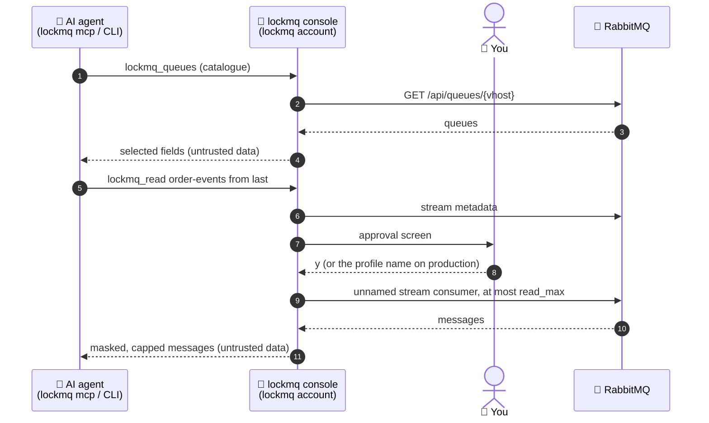

<p align="center">
  <picture>
    <source media="(prefers-color-scheme: dark)" srcset="site/assets/banner-dark.svg">
    
  </picture>
</p>

<p align="center">
  <a href="https://github.com/DavidGodefroid/lockmq/actions/workflows/ci.yml"></a>
  <a href="https://github.com/DavidGodefroid/lockmq/releases/latest"></a>
  
  
  
  <a href="LICENSE"></a>
</p>

<p align="center">
  <b>Let Claude Code, Codex, Cursor or Gemini CLI inspect your RabbitMQ brokers<br>
  without ever handing them a password.</b>
</p>

<p align="center">
  <a href="#quick-start">Quick start</a> ·
  <a href="#how-it-works">How it works</a> ·
  <a href="#safety-model">Safety model</a> ·
  <a href="#configuration">Configuration</a> ·
  <a href="#install">Install</a> ·
  <a href="docs/usage.md">Docs</a> ·
  <a href="https://davidgodefroid.github.io/lockmq/">Website</a>
</p>

---

lockmq puts a **human-held console** between your AI agent and RabbitMQ. The
agent asks; the console, running in a terminal you keep in view under its own
account, holds the broker credentials and the only broker connections, serves
an allowlist of read-only operations, masks personal data in messages and
waits for **your** approval before any message content leaves it. The agent
never sees a credential and never opens a connection.

> [!NOTE]
> **Pre-release** (`v0.1.x`). The CLI, the MCP tools and the config files may
> still change before v1. See [Install](#install).

## Why lockmq?

"Why does `orders.failed` fill up?" is a good question for an agent, and
answering it means looking at queues, bindings, policies, consumers and, in
the end, a few messages. Handing the agent `rabbitmqctl`, the management API
or an admin password gives it every write too (purge, delete, publish,
shovels), and every message body in clear. lockmq moves the key and the
decision **out of the agent**.

| | Agent with broker credentials | lockmq |
|---|:---:|:---:|
| Agent never sees the broker password | ❌ | ✅ |
| Agent has no broker connection | ❌ | ✅ |
| Only an allowlist of read operations exists | ❌ | ✅ |
| Every message read approved by a human | ❌ | ✅ |
| Message bodies, headers and properties masked | ❌ | ✅ |
| Stream reads never store an offset | ❌ | ✅ |
| Queue peek off by default, never auto-approved, refused near the delivery limit | ❌ | ✅ |
| Policy loosening needs a human confirmation | ❌ | ✅ |
| Append-only audit log (never message content) | ❌ | ✅ |

## Highlights

<table>
<tr>
<td width="50%" valign="top">

**🔑 One key holder**<br>
Credentials are typed at console start, read from the OS keychain or fetched
from HashiCorp Vault (the RabbitMQ secrets engine works as is). Never in argv,
env, files, logs, the socket or error messages; URI passwords are stripped
from every answer.

</td>
<td width="50%" valign="top">

**📋 Catalogue first, no prompt**<br>
Overview and alarms, queues (paged, filtered, sorted), one queue with its
arguments, DLX, TTL, delivery limit, policy, bindings and consumers;
exchanges, policies, connections, channels, stream offsets and consumer lag.

</td>
</tr>
<tr>
<td valign="top">

**👤 Messages, approved**<br>
`read` reads a stream from `first`, `last`, an offset or a timestamp with an
unnamed consumer: nothing stored, nothing moved. You approve each read; on
production you type the profile name.

</td>
<td valign="top">

**🧪 Peek, only if you allow it**<br>
Reading a classic or quorum queue requeues messages. It exists only on a
profile you set to tier `peek`, is approved every time, never auto-approved,
and refused near the quorum queue's delivery limit.

</td>
</tr>
<tr>
<td valign="top">

**🕶️ Masking for messages**<br>
JSON bodies masked per leaf (`redact-unknown` on production), headers and
properties by rule and name, value detectors, `<redacted:rN.K>` references;
binary and compressed bodies reduced to size and hash.

</td>
<td valign="top">

**🛡️ OS separation**<br>
`lockmq install` runs the console under its own account; the kernel checks
every peer on the socket, and the console refuses to start without it.

</td>
</tr>
<tr>
<td valign="top">

**⚖️ The AI tightens, the human loosens**<br>
The agent may add mask rules or tighten a profile; any loosening (a tier, a
limit, a vhost, a URL) waits for your confirmation in the console.

</td>
<td valign="top">

**🏷️ Refusals the agent can act on**<br>
Every refusal carries a stable code, a hint and a retry rule: rewrite, ask
the user, or stop.

</td>
</tr>
</table>

## Quick start

```sh
# 1. Install (see Install below for packages, checksums and signatures)
curl -fsSL https://raw.githubusercontent.com/DavidGodefroid/lockmq/main/scripts/install.sh | sh

# 2. Separate the console from the agent (once per machine; prints the root
#    commands and runs them with sudo after you confirm)
lockmq install

# 3. In your project: a broker profile, then your agents
lockmq setup
lockmq init

# 4. In a session of the lockmq account (switch user, Wayland), start the
#    console and keep it open
lockmq console --profile dev --project /path/to/project
```

After `lockmq install`, set a password for the console account
(`sudo passwd lockmq`) and log out and in again: your account joins the
`lockmq-clients` group at login. Then ask your agent: "which queues have no
consumer?", "why does orders.failed fill up?". Catalogue calls answer at
once; message reads wait for your approval in the console. `lockmq doctor`
checks the setup from either account.

## How it works

Two processes in two accounts. Only the console holds the key.



1. The agent calls an MCP tool (`lockmq_queues`, `lockmq_read`, ...) or the
   CLI. Both talk to the console of the profile over a Unix socket that only
   the clients group reaches; the kernel's peer credentials are checked on
   every connection.
2. The console checks that the operation exists, the vhost is served, the
   tier allows it and the arguments are in range, before any broker call.
3. Catalogue operations run at once (audited). `read` and `peek` show an
   approval screen first:

   ```
   ╭─ PROD · rabbitmq.example.com:15671 / orders · user lockmq-ro · tier peek ─────
   │ requested by uid 1000 (alice) · pid 48211 (claude)
   │ agent: see why order events fail in the dead-letter queue
   │
   │   PEEK orders.failed  count 3
   │
   │ PII: masked (2 mask rules, 1 allow rules; body redact-unknown; detectors: card, email, iban, phone)
   │ ▲ NOT READ-ONLY: messages are taken from the head and requeued; they come back redelivered=true and their delivery count grows by 1
   │ ▲ queue: quorum · ready 1204 · unacked 0 (not visible) · consumers 0
   │ ▲ delivery-limit 20 · max seen so far 2/20
   ╰─ Type the profile name "prod" to approve:
   ```

4. On approval the console reads, masks, caps the output and answers, framed
   as untrusted data. The audit log records who asked what and the decision,
   never message content.

<details>
<summary>Process layout</summary>

```
 agent account                         lockmq account (its own session)
┌──────────────────────┐   socket    ┌─────────────────────────────────────┐
│ Claude Code / Codex  │ ──────────▶ │ lockmq console                      │
│  lockmq mcp / CLI    │ ◀────────── │  policy · allowlist · masking       │
│  (no secret, no      │  JSON-RPC,  │  approval screens · audit log       │
│   broker connection) │  peer uid   │  credentials (prompt/keychain/Vault)│
└──────────────────────┘  checked    └───────────────┬─────────────────────┘
                                                     │ management API (GET)
                                                     │ stream protocol / AMQP
                                                     ▼
                                                 RabbitMQ
```

</details>

## Protocols

| Protocol | Used for | Profile key |
|---|---|---|
| Management HTTP API | every catalogue operation; `peek` (`get` with `ack_requeue_true`) | `url` (required) |
| Stream protocol | stream reads, first/last offsets, a named consumer's stored offset | `stream_url` |
| AMQP 0-9-1 | stream reads (`x-stream-offset` consumer) when the stream port is not reachable, or through ssh | `amqp_url` |

One broker user for all three. Tested against RabbitMQ 3.13 and 4.1. lockmq
never calls `/api/definitions`, `/api/users*`, other users'
`/api/permissions*`, any non-GET endpoint but the `get` of `peek`,
`basic.get`, `basic.publish`, a declare, a delete, a purge or `store_offset`.

## Safety model

The console is the enforcement point; skills, rules and tool descriptions
only guide the agent. The full model, its threats and its limits are in
[docs/security-model.md](docs/security-model.md). In short:

- **Separate account.** `lockmq install` creates the console account, the
  clients group and `/etc/lockmq/system.toml`; the console refuses to start
  without them.
- **Allowlist.** What is not in the catalogue does not exist.
- **Read-only by default.** Tier `read` reads metadata and streams, and moves
  nothing. Tier `peek` is not strictly read-only and is labelled as such
  everywhere.
- **Human approval.** Every `read` and `peek` is shown and approved in the
  console terminal; no socket method can approve. On a production profile you
  type the profile name. No answer within 5 minutes means denied.
- **Credentials.** Asked at console start (no echo), read from the console
  account's keychain, or read from Vault at every connection. Errors that
  leave the console are scrubbed of known secrets, URI userinfo and
  `Authorization` headers.
- **Broker user.** Use a user tagged `monitoring` with `configure "^$"` and
  `write "^$"`. RabbitMQ lets the `read` permission **purge** a queue: grant
  `read` on the streams only, and on queues only for profiles with tier
  `peek`. At start the console refuses an `administrator` or `policymaker`
  user on production, and asks for a typed `continue` elsewhere.
- **Audit.** One JSON line per login, policy change, catalogue call,
  refusal, decision, run and logout, with the agent's intent and the client's
  uid. Never a message body, header or property value.

### Peek (tier `peek`)

The management `get` takes up to `count` ready messages from the head and
requeues them in the same call. Consequences, all on the approval screen:
redelivered messages, a delivery count that grows on quorum queues (over the
limit, the message is dead-lettered or dropped), a possible change of order
for active consumers, and only ready messages at the head are visible. The
console reads the effective delivery limit (argument, policy, operator
policy; the lowest; RabbitMQ 4.x's default 20) and refuses a peek within
`delivery_headroom` of it, from the highest count it saw this session.

## Configuration

Profiles live in `.lockmq/config.toml` at the project root. No file holds a
secret: a URL with a password is refused.

```toml
[profiles.prod]
url          = "https://rabbitmq.example.com:15671"   # management API
amqp_url     = "amqps://rabbitmq.example.com:5671"    # optional
stream_url   = "rabbitmq-stream+tls://rabbitmq.example.com:5551"  # optional
vhosts       = ["orders"]                              # empty: every vhost the account sees
user         = ""                                      # empty: asked at console start
credentials  = "vault"                                 # ask | keychain | vault
vault_path   = "rabbitmq/creds/lockmq-ro"
tls          = "verify-full"
tier         = "read"                                  # read | peek
production   = true
detectors    = ["email", "phone", "iban", "card"]
body_mode    = "redact-unknown"                        # redact-unknown | detect

[profiles.prod.limits]
request_timeout   = "10s"
read_max          = 20      # messages per stream read (ceiling 200)
peek_max          = 5       # messages per peek (ceiling 20)
delivery_headroom = 3
max_body_bytes    = 16384
max_output_bytes  = 65536
list_page_size    = 100
idle_timeout      = "20m"
max_session       = "4h"
```

An `[profiles.NAME.ssh]` table reaches a broker behind a bastion: the console
opens the tunnel itself and checks the bastion's host key; streams are then
read over AMQP.

<details>
<summary>All profile keys</summary>

| Key | Default | Notes |
|---|---|---|
| `url` | required | management API, `http://` or `https://`; no userinfo |
| `amqp_url`, `stream_url` | none | optional; an operation that needs a missing one says which key to set |
| `vhosts` | every vhost the account sees | the only vhosts served |
| `user` | asked at start | with `credentials = "vault"`: the secret's username |
| `credentials` | `ask` | `ask`, `keychain` or `vault` |
| `vault_path` | required with `vault` | e.g. `rabbitmq/creds/<role>` |
| `credentials_ttl` | none | at least `1m`: the secret is asked again once it is that old |
| `tls` | `verify-full` | `disable`, `prefer`, `require`, `verify-ca`, `verify-full` |
| `tls_ca`, `tls_cert`, `tls_key` | none | a private CA; a client certificate (both or neither) |
| `tier` | `read` | `read` or `peek` |
| `production` | `false` | typed approval, `redact-unknown` body mode, auto mode unavailable |
| `detectors` | `card`, `email`, `iban`, `phone` | also `be_niss`, `fr_nir`, `nl_bsn`, `us_ssn`; `[]` disables them |
| `body_mode` | `redact-unknown` on production, `detect` otherwise | |
| `limits.request_timeout` | 10s | |
| `limits.read_max` | 20 | ceiling 200 |
| `limits.peek_max` | 5 | ceiling 20 |
| `limits.delivery_headroom` | 3 | lowering it is a loosening |
| `limits.max_body_bytes` | 16 384 | per message after masking |
| `limits.max_output_bytes` | 65 536 | messages dropped from the end and counted |
| `limits.list_page_size` | 100 | |
| `limits.idle_timeout`, `limits.max_session` | 20m, 4h | session ends after this long idle / in all |
| `ssh.host`, `ssh.port`, `ssh.user`, `ssh.auth`, `ssh.key`, `ssh.credentials` | port 22 | as in locksql: `auth` is `key`, `agent` or `password` |

</details>

Changing the file later: tightenings (a lower limit, `peek` → `read`, a
removed vhost, a new mask rule) apply at once; loosenings wait for you in the
console (`:review`).

### PII rules

`.lockmq/pii.toml`:

```toml
[[mask]]
queue = ["orders/order-events"]     # vhost/name globs; "//name" for the vhost /
body  = "$.customer.email"          # JSON path: $.a.b, $.a[*].b, $.a[3]
mode  = "email"                     # redact (default) | partial | email

[[mask]]
queue  = ["*/*"]
header = "x-customer-*"

[[allow]]
queue = ["orders/order-events", "orders/order-events.dlq"]
body  = "$.items[*].sku"
```

Mask rules of the queue read, of the origin queue in a message's first
`x-death` and of its exchange apply; allow rules only from the queue read, so
a forged `x-death` can only add masking. The agent may add a mask rule
(`lockmq pii add`); an allow rule is a loosening the human confirms.

## Console keys

| Key / command | Does |
|---|---|
| `:review` | show the pending loosening and the change requests of clients, apply or refuse |
| `:status` | the policy in force, the session |
| Shift+Tab, `:mode` | auto mode on/off (never on production; never for `peek`) |
| `:quit`, Ctrl-C | end the session |

The switches are console-only: no client, config file or environment
variable can set them, and each change is audited.

## Limitations

- No writes of any kind in v0.1 (purge, move, requeue, publish, shovel).
- RabbitMQ only; JSON and UTF-8 text bodies only, other bodies are shown as
  size and hash.
- Masking is best effort: a value in a free-text field that no detector,
  rule or name heuristic catches comes back in clear.
- A `monitoring` user cannot read runtime parameters (shovels, federation)
  nor its own permissions: `policies` says so; permissions are not audited.
- Through an ssh tunnel the stream protocol is unavailable (its client dials
  the broker's advertised address): streams are read over AMQP, and stream
  offsets and consumer lag are not available.
- The first peek of a queue cannot know the delivery counts (the count is
  only seen after a `get`); the screen says so.
- The console runs on the host, in the separated account; no console in a
  container yet. One console per profile and project, one request at a time.

## Roadmap

Not in v0.1, and not promised for a given release:

- clear results in the console (Ctrl-O) and unmasked output on request
  (`:unmask`), as in locksql;
- the console in a container, as locksql's Docker mode;
- body formats beyond JSON and UTF-8 text;
- an `update` command that checks the release signature, as `locksql update`.

## The lock family

lockmq is one of a family of human-gated tools for AI agents, built on the
same console, separation and approval model:

| Project | Gates access to |
|---|---|
| [locksql](https://github.com/DavidGodefroid/locksql) | databases: MariaDB, MySQL, PostgreSQL, SQLite |
| **lockmq** | message queues: RabbitMQ |
| [lockfile](https://github.com/DavidGodefroid/lockfile) | files: yes/no answers about a file the agent never reads |
| [lockkit](https://github.com/DavidGodefroid/lockkit) | the shared Go framework: console, separation, approval, masking, audit, MCP |

## Documentation

| | |
|---|---|
| 📘 [docs/usage.md](docs/usage.md) | every command, the console, the MCP tools, refusal codes |
| 🛡️ [docs/security-model.md](docs/security-model.md) | principles, boundaries, threats and limits |
| 🐳 [docs/docker.md](docs/docker.md) | a broker in a container; the read-only broker user |
| 📝 [CHANGELOG.md](CHANGELOG.md) | release notes |
| 🚨 [SECURITY.md](SECURITY.md) | reporting a vulnerability |
| 🧑‍💻 [CONTRIBUTING.md](CONTRIBUTING.md) | building and testing |

## Install

Every release ships a static binary for Linux and macOS (amd64, arm64),
`.deb`, `.rpm` and `.apk` packages, an SPDX SBOM per archive, a
`checksums.txt` and its keyless cosign signature. No Go toolchain is needed.

**Script (Linux, macOS).** Downloads the archive for your OS and architecture,
checks it against `checksums.txt` (and its signature when `cosign` is on
PATH), then installs `/usr/local/bin/lockmq`, with `sudo` if needed:

```sh
curl -fsSLO https://raw.githubusercontent.com/DavidGodefroid/lockmq/main/scripts/install.sh
less install.sh                     # read it first
sh install.sh                       # LOCKMQ_VERSION=v0.1.0 to pin a version
```

`LOCKMQ_REQUIRE_COSIGN=1` fails instead of warning when `cosign` is missing.
`LOCKMQ_INSTALL_DIR` installs elsewhere, but `lockmq install` copies only a
binary the agent's account cannot replace.

**Debian, Ubuntu, Fedora, RHEL, Alpine.** Packages install
`/usr/bin/lockmq`, owned by root:

```sh
V=0.1.0
A=$(uname -m | sed 's/x86_64/amd64/; s/aarch64/arm64/')
U=https://github.com/DavidGodefroid/lockmq/releases/download/v$V/lockmq_${V}_linux_$A

# Debian, Ubuntu
curl -fsSLO $U.deb && sudo apt install ./lockmq_${V}_linux_$A.deb
# Fedora, RHEL
sudo dnf install $U.rpm
# Alpine
curl -fsSLO $U.apk && sudo apk add --allow-untrusted ./lockmq_${V}_linux_$A.apk
```

**By hand.** Download `lockmq_<version>_<os>_<arch>.tar.gz`, `checksums.txt`
and `checksums.txt.sigstore.json` from the
[releases page](https://github.com/DavidGodefroid/lockmq/releases), then:

```sh
cosign verify-blob --bundle checksums.txt.sigstore.json \
  --certificate-identity-regexp '^https://github.com/DavidGodefroid/lockmq/' \
  --certificate-oidc-issuer https://token.actions.githubusercontent.com \
  checksums.txt
sha256sum --ignore-missing -c checksums.txt   # macOS: shasum -a 256 --ignore-missing -c checksums.txt
tar -xzf lockmq_<version>_<os>_<arch>.tar.gz lockmq
sudo install -m 0755 lockmq /usr/local/bin/lockmq
```

**From source.** `go install github.com/DavidGodefroid/lockmq/cmd/lockmq@latest`
(Go 1.26 or later), then `lockmq install --trust-binary`.

## Build

```sh
CGO_ENABLED=0 go build ./cmd/lockmq
go test ./...
go test -tags integration ./test/integration/   # RabbitMQ 3.13 and 4.1 in Docker
```

Requires Go 1.26 or later.

## Licence

Apache License 2.0. See [LICENSE](LICENSE) and [NOTICE](NOTICE).
