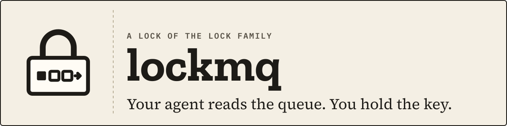
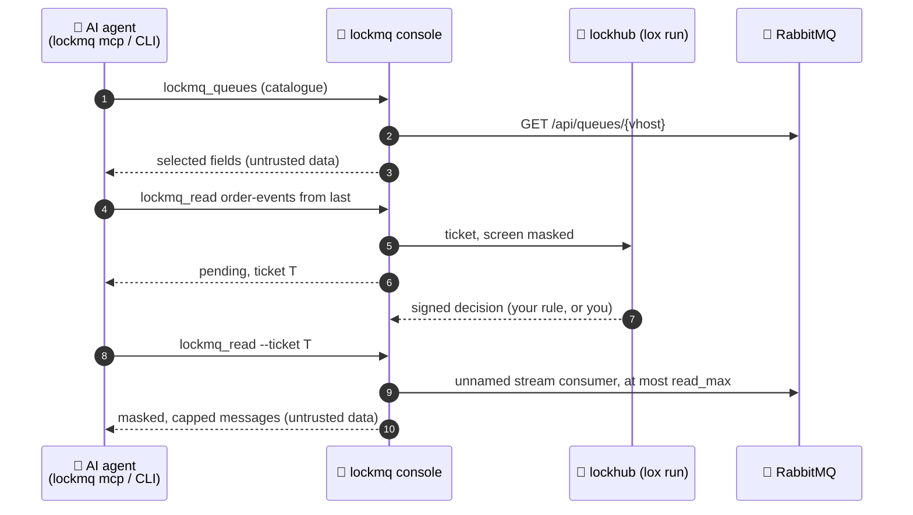

<p align="center">
  <picture>
    <source media="(prefers-color-scheme: dark)" srcset="docs/assets/banner-dark.svg">
    
  </picture>
</p>

<p align="center">
  <a href="https://github.com/DavidGodefroid/lockmq/actions/workflows/ci.yml"></a>
  <a href="https://github.com/DavidGodefroid/lockmq/releases"></a>
  <a href="LICENSE"></a>
  <a href="go.mod"></a>
</p>

<p align="center"><b>Let any AI agent inspect your RabbitMQ brokers: message contents come back masked,<br>
connections and queue reads wait for you, and the agent never holds a password.</b></p>

<p align="center">
  
</p>
<p align="center"><sub>An agent (here Claude Code, left) and the lockmq console (right). Recorded before decisions moved to lockhub: today you answer in <code>lox run</code>, and stream reads pass on the default rules.</sub></p>

<p align="center">
  <a href="#quick-start">Quick start</a> ·
  <a href="#how-it-works">How it works</a> ·
  <a href="#documentation">Docs</a> ·
  <a href="#the-lock-family">Lock Family</a> ·
  <a href="https://davidgodefroid.github.io/lockmq/">Website</a>
</p>

---

lockmq is a Lock of the [Lock Family](https://github.com/DavidGodefroid/lockfamily),
harness security for AI agents. A **console** sits between your agent and
RabbitMQ: it holds the broker credentials and the only broker connections,
serves an allowlist of read operations and masks personal data in messages.
The agent only asks.

> [!NOTE]
> **Pre-release** (`v0.8.x`): a release may still change the config files,
> the MCP tools or the CLI.

## Why lockmq

- **The agent never holds a password.** Credentials are typed at console
  start or read from Vault, in an account and a container the agent cannot reach.
- **Approval outside the agent.** Each message read becomes a ticket on
  [lockhub](https://github.com/DavidGodefroid/lockhub), decided in `lox run`.
  Lists and stream reads pass on your rules; connections and queue peeks wait for you.
- **Personal data stays masked.** Bodies, headers and properties are masked
  per field; on production every string no allow rule names is redacted.
- **Nothing moves.** Stream reads store no offset; there are no writes, and
  a queue peek (which requeues) exists only on a profile you allow.

Handing the agent `rabbitmqctl` or an admin password gives it every write
too, and every message body in clear. lockmq moves the key and the decision
**out of the agent**.

## Install

```sh
brew trust davidgodefroid/tap
brew install davidgodefroid/tap/lox davidgodefroid/tap/lockmq
```

lockmq runs in Docker: Homebrew installs the `lockmq` launcher, which runs
every command in the release's signed image. `lox` is lockhub's CLI. The
whole family instead: `brew install davidgodefroid/tap/lockfamily`.

Without Homebrew, the signed install script of a release:

```sh
V=vX.Y.Z
curl -fsSLO "https://raw.githubusercontent.com/DavidGodefroid/lockmq/$V/scripts/install.sh"
less install.sh
LOCKMQ_VERSION=$V sh install.sh
```

Linux and macOS, on amd64 and arm64 (`CGO_ENABLED=0`); on Windows, WSL 2
with Docker Desktop. Launcher, image, Vault image, lea and building from
source: [docs/install.md](docs/install.md).

## Quick start

1. In your project, add the broker. `lox add` asks where it is (never the
   password), writes the profile, wires your agent and starts the console:

   ```sh
   lox add lockmq
   ```

2. In a terminal of its own, outside any agent, keep `lox run` open. Every
   ticket shows up there:

   ```sh
   lox run
   ```

3. Start your agent in the project (`claude`, `codex`, `gemini`, …) and ask:
   *"which queues have no consumer?"*

`lox add` wires Claude Code; for Codex, Cursor or Gemini CLI, also run
`lockmq init codex` (or `cursor`, `gemini`). With
[lea](https://github.com/DavidGodefroid/lea), run `lox add` in lea's projects
directory, then `lea stop` and `lea`. Step by step, by hand:
[docs/install.md](docs/install.md#by-hand).

## Highlights

<table>
<tr>
<td width="50%" valign="top">

**🔑 One key holder**<br>
Credentials live in the console only: never in argv, env, files, logs, the
socket or an error message. URI passwords are stripped from every answer.

</td>
<td width="50%" valign="top">

**👤 Your rules, your decisions**<br>
Per profile, each action is `auto`, `ask` or `deny`. By default lists and
stream reads pass; the first connection and every peek are asked.

</td>
</tr>
<tr>
<td valign="top">

**🕶️ Masking for messages**<br>
JSON bodies masked per leaf, headers and properties by rule and name,
value detectors; binary bodies reduced to size and hash.

</td>
<td valign="top">

**🧪 Peek, only if you allow it**<br>
Reading a classic or quorum queue requeues messages: it exists only on a
profile set to tier `peek`, and is refused near the delivery limit.

</td>
</tr>
</table>

More: [the catalogue and the protocols](docs/architecture.md), [the
safety model and its limits](docs/safety.md), and [every
profile key](docs/configuration.md).

## How it works

Two processes in two containers. Only the console holds the key.



1. The agent calls an MCP tool (`lockmq_queues`, `lockmq_read`, …) or the
   CLI. The console checks the operation, the vhost, the tier and the
   arguments before any broker call.
2. Catalogue calls run at once. A read or a peek becomes a ticket on
   lockhub, and the agent gets `pending`.
3. `lox run` decides, on your profile's rules or by asking you. The console
   checks the signed decision, reads, masks and caps the messages.

RabbitMQ 3.13 and 4.1, through the management API, the stream protocol and
AMQP 0-9-1. The approval screen, the process layout and the protocols:
[docs/architecture.md](docs/architecture.md).

## Safety model

- **The console is the enforcement point.** Skills, rules and MCP tool
  descriptions only guide the agent; the console's checks are the guarantee.
- **OS separation.** The console runs as its own account in its own
  container; the kernel checks every peer on the socket.
- **Allowlist, read-only broker user.** What is not in the catalogue does
  not exist. Use a `monitoring` user with empty `configure` and `write`.
- **The AI tightens, the human loosens.** The agent may add mask rules; any
  loosening of the policy waits for your confirmation in the console.
- **Audit.** Every decision, refusal and run goes to an append-only JSONL
  log, never with a message body, header or property value.
- **Known limits.** Masking is best effort, RabbitMQ lets the `read`
  permission purge a queue, and whoever can run `docker` commands can reach
  the console's container.

Every rule and limit: [docs/safety.md](docs/safety.md). Threat model:
[docs/security-model.md](docs/security-model.md).

## Documentation

| Doc | What it covers |
|---|---|
| [docs/install.md](docs/install.md) | install paths, by hand, the launcher and its image, building |
| [docs/docker.md](docs/docker.md) | the setup guide: image, project, console, agent wiring, broker in a container |
| [docs/usage.md](docs/usage.md) | every command, auto rules, the console, the MCP tools, refusal codes |
| [docs/configuration.md](docs/configuration.md) | every profile key, auto rules, SSH, PII rules |
| [docs/architecture.md](docs/architecture.md) | the life of a request, the approval screen, process layout, protocols |
| [docs/safety.md](docs/safety.md) | the safety model, peek, console keys, limitations, roadmap, the comparison and highlights in full |
| [docs/security-model.md](docs/security-model.md) | principles, boundaries, threats and limits |
| [CHANGELOG.md](CHANGELOG.md) | what changed, release by release |

The site, [davidgodefroid.github.io/lockmq](https://davidgodefroid.github.io/lockmq/),
is built from [`site/`](site/).

## The Lock Family

| Repo | What it does |
|---|---|
| [lockfamily](https://github.com/DavidGodefroid/lockfamily) | The family site ([lockfamily.dev](https://lockfamily.dev)) and the one-line installer. |
| [locksql](https://github.com/DavidGodefroid/locksql) | SQL databases: the agent queries, PII comes back masked; connections and writes wait for you. |
| [lockmq](https://github.com/DavidGodefroid/lockmq) | RabbitMQ: masked queue inspection; connections, peeks and unmasked reads wait for you. |
| [lockfile](https://github.com/DavidGodefroid/lockfile) | Files (S3, SFTP, disk): the agent asks yes/no questions about files it never reads. |
| [lockhttp](https://github.com/DavidGodefroid/lockhttp) | Outbound HTTP(S): reads of trusted hosts pass; anything that sends data or reaches an unknown host waits for you. |
| [locklog](https://github.com/DavidGodefroid/locklog) | Logs: masked, bounded log search; the agent reads the logs, not the people in them. |
| [lockssh](https://github.com/DavidGodefroid/lockssh) | Commands over SSH: allow-listed commands run at once, the rest waits for you; the key never leaves the console. |
| [lockhub](https://github.com/DavidGodefroid/lockhub) | The approval hub and its `lox` CLI: `lox run` approves outside the agent's harness and never sees values in clear. |
| [lockkit](https://github.com/DavidGodefroid/lockkit) | The shared Go core of every Lock: console, policies, masking, signed tickets, audit, MCP. |
| [lea](https://github.com/DavidGodefroid/lea) | Runs many agents in containers, wired to the Locks. |

## Contributing · Security · License

- **Contributing:** [CONTRIBUTING.md](CONTRIBUTING.md). Build with
  `CGO_ENABLED=0 go build ./cmd/lockmq` (Go 1.26+).
- **Security:** report a vulnerability privately, see [SECURITY.md](SECURITY.md).
- **License:** Apache License 2.0, see [LICENSE](LICENSE) and [NOTICE](NOTICE).
