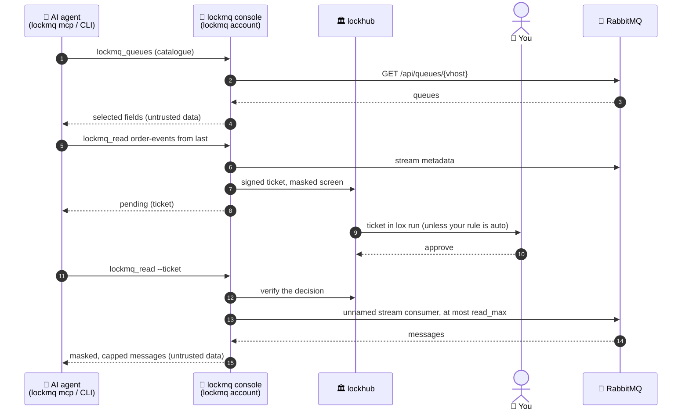

# How lockmq works

Two processes in two accounts. Only the console holds the key.



1. The agent calls an MCP tool (`lockmq_queues`, `lockmq_read`, ...) or the
   CLI. Both talk to the console of the profile over a Unix socket that only
   the clients group reaches; the kernel's peer credentials are checked on
   every connection.
2. The console checks that the operation exists, the vhost is served, the
   tier allows it and the arguments are in range, before any broker call.
3. Catalogue operations run at once (audited). `read` and `peek` build an
   approval screen first, sent to lockhub as a signed ticket:

   ```
   ╭─ PROD · rabbitmq.example.com:15671 / orders · user lockmq-ro · tier peek ─────
   │ requested by uid 1000 (alice) · pid 48211 · process "lockmq" (self-reported name)
   │ agent: see why order events fail in the dead-letter queue
   │
   │ PEEK orders.failed  count 3
   │
   │ PII: masked (2 mask rules, 1 allow rules; body redact-unknown; detectors: card, email, iban, phone)
   │ ▲ NOT READ-ONLY: messages are taken from the head and requeued; they come back redelivered=true and their delivery count grows by 1
   │ ▲ queue: quorum · ready 1204 · unacked 0 (not visible) · consumers 0
   │ ▲ delivery-limit 20 · max seen so far 2/20
   ╰─ pending: ticket 01J…
   ```

4. On approval the console reads, masks, caps the output and answers, framed
   as untrusted data. The audit log records who asked what and the decision,
   never message content.

## Process layout

```
 agent's container (agent)             console container (lockmq)
┌──────────────────────┐   socket    ┌─────────────────────────────────────┐
│ your AI agent        │ ──────────▶ │ lockmq console                      │
│  lockmq mcp / CLI    │ ◀────────── │  policy · allowlist · masking       │
│  (no secret, no      │  JSON-RPC,  │  approval screens · audit log       │
│   broker connection) │  peer uid   │  credentials (prompt/Vault)         │
└──────────────────────┘  checked    └───────────────┬─────────────────────┘
                                                     │ management API (GET)
                                                     │ stream protocol / AMQP
                                                     ▼
                                                 RabbitMQ
```


Every client command, `lockmq mcp` and `lockmq doctor` also take `--instance NAME`, to
reach one lock among several of this type that lea mounts (without it:
`$LOCKMQ_INSTANCE`, else the one lock in `$LEA_LOCKMQ_INSTANCES`). `lockmq console`
and `lockmq hub-key` take an `--instance` too, but that one is the name `lox up`
gives the lock.

## Protocols

| Protocol | Used for | Profile key |
|---|---|---|
| Management HTTP API | every catalogue operation; `peek` (`get` with `ack_requeue_true`) | `url` (required) |
| Stream protocol | stream reads, first/last offsets, a named consumer's stored offset | `stream_url` |
| AMQP 0-9-1 | stream reads (`x-stream-offset` consumer) when the stream port is not reachable, or through ssh | `amqp_url` |

One broker user for all three. Tested against RabbitMQ 3.13 and 4.1. lockmq
never calls `/api/definitions`, `/api/users*`, other users'
`/api/permissions*`, any non-GET endpoint but the `get` of `peek`,
`basic.get`, `basic.publish`, a declare, a delete, a purge or `store_offset`.
